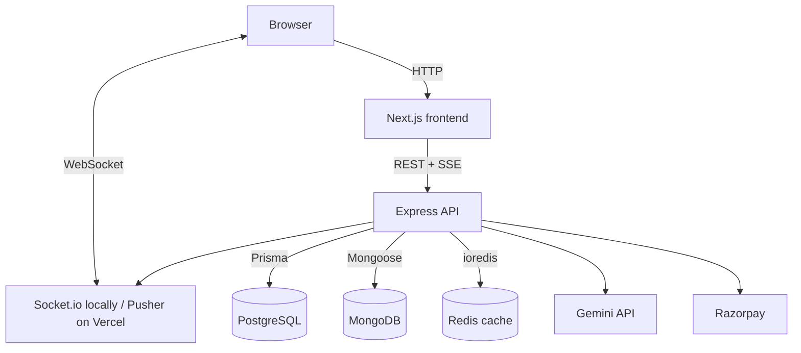

<div align="center">
  
  <h1>FinSense</h1>
  <p><b>An AI-powered personal finance tracker: log expenses in plain English, ask questions about your spending, and get a budget health report.</b></p>

[](https://nextjs.org/)
[](https://expressjs.com/)
[](https://postgresql.org/)
[](https://mongodb.com/)
[](https://redis.io/)
[](https://ai.google.dev/)
[](https://docker.com/)

**[Live demo](https://your-app.vercel.app)** · [Product requirements](PRD.md) · [High-level design](HLD.md) · [Low-level design](LLD.md) · [Deploying to Vercel](DEPLOY_VERCEL.md)

</div>

---

## Why I built this

Most budgeting apps fail for the same reason: logging every expense by hand, picking a category, and reading static charts gets tedious, so people stop. I wanted to see how far I could reduce that friction with an LLM. In FinSense you type something like *"Swiggy order 450"* and the app works out the amount, merchant and category for you. You can then ask questions like *"How much did I spend on food this month?"* and get an answer grounded in your own transactions.

I built FinSense as my capstone project, end to end: the database design, the Express API, the AI features, the Next.js frontend, the tests and the deployment.

<!-- Add 2–3 screenshots here: dashboard, chat, budget health report -->

## Features

**AI features (Google Gemini)**
- **Auto-categorization with structured output.** When you add an expense, Gemini returns strict JSON (category, merchant, amount, confidence) validated against a response schema. It reuses your existing categories where they fit and only proposes a new one when nothing matches.
- **Chat over your own data (RAG).** Every transaction is embedded with a Gemini embedding model and stored in MongoDB. When you ask a question, I embed the question, rank your transactions by cosine similarity, and pass the top matches to the model as context. Replies stream to the browser word by word over Server-Sent Events.
- **Tool calling in chat.** The chat model can call backend functions: `get_spending_summary`, `get_category_comparison`, `get_recent_transactions` and `create_transaction`. So *"add 50 for groceries"* creates a real transaction.
- **Budget Health Agent.** A multi-step agent loop: the model decides which tools to call and in what order, gathers what it needs, then writes a report with a verdict, observations and recommendations. It's capped at 5 steps, and the API returns the full trace of tool calls so the UI can show how the agent got to its answer.
- **Prompt-injection guard.** Prompts treat expense descriptions as data, never as instructions.
- **Token and cost tracking.** Every LLM call logs input and output tokens and an estimated USD cost to Postgres.
- **Eval script.** `npm run eval` runs a hand-labelled set of real-world expense descriptions through the production categorizer and reports accuracy, so prompt changes can be checked for regressions.

**App features**
- Email/password auth (bcrypt + JWT) and Google sign-in, with role-based access for an admin stats endpoint.
- Transactions with full CRUD, custom categories and optional receipt image uploads (local disk in development, Vercel Blob in production).
- Real-time sync: add an expense in one tab or device and it shows up in the others. Locally this uses Socket.io with a private, JWT-authenticated room per user; on Vercel it uses a private Pusher channel per user, because serverless functions can't hold WebSocket connections.
- Daily spending digest stored in MongoDB, scheduled by `node-cron` locally and by Vercel Cron in production, with a manual "run now" button for demos.
- Pro plan upgrade flow with Razorpay checkout and server-side signature verification (test mode).

## Architecture



| Layer | Technology |
| --- | --- |
| Frontend | Next.js 14, React 18, Tailwind CSS, Axios, Socket.io client, Pusher JS |
| Backend | Node.js, Express, Zod validation, express-rate-limit, Multer |
| Relational data | PostgreSQL via Prisma: users, categories, transactions, subscriptions, LLM usage logs |
| Document data | MongoDB via Mongoose: chat history, daily digests, transaction embeddings |
| Cache | Redis: dashboard summary cached for 60 seconds |
| AI | Google Gemini via `@google/genai`: structured output, tool calling, embeddings, streaming |
| DevOps | Docker Compose for local development, GitHub Actions CI, Vercel (API as a serverless function + Next.js frontend) |

### Design decisions

- **Two databases, on purpose.** Money data lives in Postgres, where I want a fixed schema, foreign keys and transactions; amounts are stored as `Decimal(12,2)`, never floats. Chat messages, digests and embeddings live in MongoDB because their shape varies (a digest's category breakdown is different for every user) and they don't need joins.
- **Embeddings in MongoDB instead of pgvector.** For this project's data size, computing cosine similarity in Node over one user's transactions is fast enough and avoided adding another Postgres extension. At larger scale I'd move this to pgvector or a dedicated vector store.
- **Redis is optional and fails open.** If Redis is down or not configured, the app runs the same, just without the cache. Writes invalidate the cached summary.
- **Rate limits on the expensive paths.** LLM-backed routes (chat, agent, adding a transaction) have their own limiter, separate from the auth limiter that slows down brute-force attempts.
- **SSE for chat, WebSockets for sync.** Chat replies are a one-way server-to-client stream, so SSE is the simpler fit. Cross-device sync needs a persistent, authenticated two-way connection, so that uses Socket.io.
- **Same code, two runtimes.** Locally the API is a long-running Node server; on Vercel the same Express app runs as a serverless function. Anything that assumed a persistent process had a serverless replacement: Socket.io → Pusher, `node-cron` → Vercel Cron, local disk → Vercel Blob, and background work after a response (embeddings, realtime pushes) goes through `waitUntil` so the function isn't frozen mid-task.

## Running it locally

**Prerequisites:** Node.js 20+, Docker Desktop, and a [Gemini API key](https://aistudio.google.com/apikey).

### Option 1: Docker Compose (everything in containers)

```bash
git clone https://github.com/Horror-Novel/finsense.git
cd finsense
cp .env.example .env        # then set JWT_SECRET and GEMINI_API_KEY
docker compose up --build
```

This starts PostgreSQL, MongoDB, Redis, the API and the frontend.
- Frontend: http://localhost:5173
- API: http://localhost:5000/api (health check at `/api/health`)

Google sign-in and Razorpay are optional. If you leave their keys blank, the Google button is hidden and the pricing page shows payments as not configured.

### Option 2: Run the apps directly

Start the databases with Docker, then run the API and frontend from the repo root:

```bash
docker compose up -d postgres mongo redis
cp backend/.env.example backend/.env    # fill in GEMINI_API_KEY and JWT_SECRET
npm install
npm run prisma:migrate
npm run prisma:seed                     # optional sample data
npm run dev:backend
npm run dev:frontend                    # in a second terminal
```

## Deployment

The live app runs on Vercel as two projects from this repo: the Express API as a serverless function (`backend/`, Mumbai region) and the Next.js frontend (`frontend/`), which proxies `/api/*` to the API. Data lives in Neon Postgres, MongoDB Atlas, Vercel Blob and optionally Upstash Redis. Step-by-step instructions are in [DEPLOY_VERCEL.md](DEPLOY_VERCEL.md).

## Tests and CI

```bash
npm test               # all backend tests (Jest + Supertest)
npm run test:unit      # unit tests only
npm run eval           # categorization accuracy against the live Gemini API
```

Unit tests cover the validators, auth and error-handling middleware, the cosine similarity function used for RAG, and the LLM cost calculator. GitHub Actions runs the unit tests and a production frontend build on every push and pull request to `main`.

## Project structure

```
finsense/
├── backend/
│   ├── src/
│   │   ├── controllers/   # request handlers
│   │   ├── routes/        # Express routers
│   │   ├── services/      # LLM, RAG, agent, tools, payments, cron, sockets
│   │   ├── middleware/    # auth, validation, rate limiting, uploads, errors
│   │   ├── models/        # Mongoose models
│   │   └── config/        # Postgres, Mongo, Redis, Gemini clients
│   ├── prisma/            # schema and seed script
│   ├── tests/             # Jest unit and integration tests
│   └── evals/             # LLM categorization eval
├── frontend/              # Next.js app (pages, components, context)
├── PRD.md · HLD.md · LLD.md
└── docker-compose.yml
```

## What I'd improve next

- Move embeddings to pgvector so similarity search runs in the database instead of in Node.
- Read receipt images with Gemini's vision input to pre-fill the expense, instead of only storing them.
- Gate features by plan on the server; the Pro plan is currently tracked and shown but doesn't unlock anything yet.
- Grow the eval set and run it in CI against a fixed model version.

## Author

**Kartik Sharma**
- GitHub: [@Horror-Novel](https://github.com/Horror-Novel)
<!-- Add your LinkedIn / portfolio / email here -->
